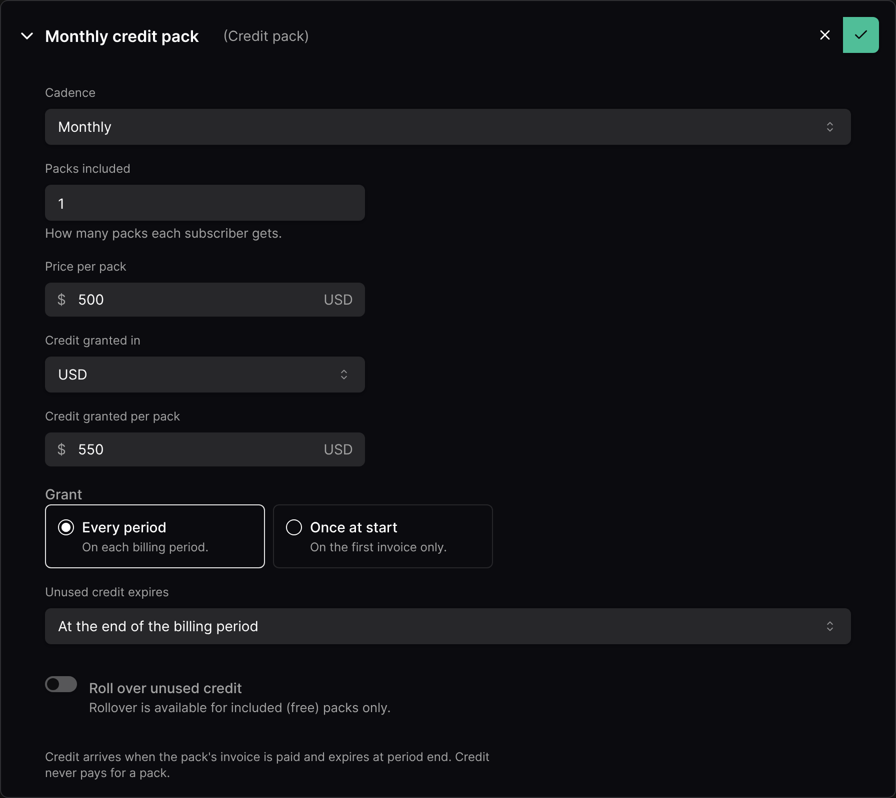

A **credit pack** is a plan component that grants credit every billing period, or once when the subscription starts. It can be **sold** ("$500 a month for $550 of credit") or **included** for free ("5,000 credits a month").

## Adding a credit pack

In the plan editor, add a component and choose the fee type **Credit pack**.

<Frame>
  
</Frame>

| Field | Description |
| --- | --- |
| **Cadence** | Monthly, Quarterly, Semiannual or Annual |
| **Packs included** | How many packs each subscriber gets |
| **Price per pack** | Set it to **0** for an included (free) pack |
| **Credit granted in** | The plan's currency, or a [credit unit](/credits/credit-units) |
| **Credit granted per pack** | The amount of credit each pack adds |
| **Grant** | **Every period**, or **Once at start** (welcome credit) |
| **Unused credit expires** | Never, at the end of the billing period (default), or after a number of days or months |
| **Roll over unused credit** | Included packs only. See [Rollover](#rollover) |

Plan credit belongs to its subscription: it pays that subscription's usage only, and ends with it.

## Paid and included packs

|  | Paid pack | Included pack (price 0) |
| --- | --- | --- |
| Billed | In advance, on each period's invoice | Not billed |
| Credit added | When the invoice is **paid** | When the period's invoice is finalized |
| Credit type | Paid | Promotional |

Until a paid pack's invoice is paid, the subscription shows the credit as waiting on that payment. Credit never pays for a pack: the pack fee is always collected in money.

### Bonus credit

A money pack priced below the credit it grants adds two parts: paid credit worth its price, and **bonus credit** for the rest. A $500 pack granting $550 adds $500 of paid credit and $50 of bonus credit (shown as "+10% bonus" on the plan).

Bonus credit is promotional: it is used first and comes off before tax.

### Welcome credit

A pack granted **Once at start**, priced at 0, is welcome credit: granted on the subscription's first invoice, kept across plan changes, and never granted twice to the same subscription.

## Rollover

Included packs granted every period can carry their unused credit over once:

* **Most credit carried per pack**: an optional cap. Leave it empty to carry everything left.
* **Rolled credit expires**: a number of days or months after the original expiry.

Rolled-over credit is used before the next period's credit, and never rolls over again.

**Example.** 5,000 included credits a month, up to 1,000 rolling over for one month:

| Month | Used | Paid by | Rolls over | Expires |
| --- | --- | --- | --- | --- |
| August | 3,800 | August credit | 1,000 (capped) | 200 |
| September | 5,600 | 1,000 rolled over + 4,600 September credit | 400 | — |

## When credit runs out

By default, a plan with a credit pack **denies access at zero**: access checks return denied once the credit is used up, until credit is added. You can instead invoice the overage, with or without a cap. See [When credit runs out](/credits/limits-and-budgets#when-credit-runs-out).

## Plan changes and cancellation

* **Mid-period start**: packs that reset each period are prorated, fee and credit alike. Welcome credit is granted in full.
* **Immediate plan change or cancellation**: usage up to the change is paid from the old pack first. The unused share of the old pack is then credited back and its credit removed. The new plan's pack is prorated.
* Packs with another expiry are purchases: never prorated or credited back. They are kept across plan changes and end with the subscription.

<Note>
  A recurring paid pack counts in MRR at its price. Included and once-at-start packs don't. Packs never count toward a minimum commitment.
</Note>
