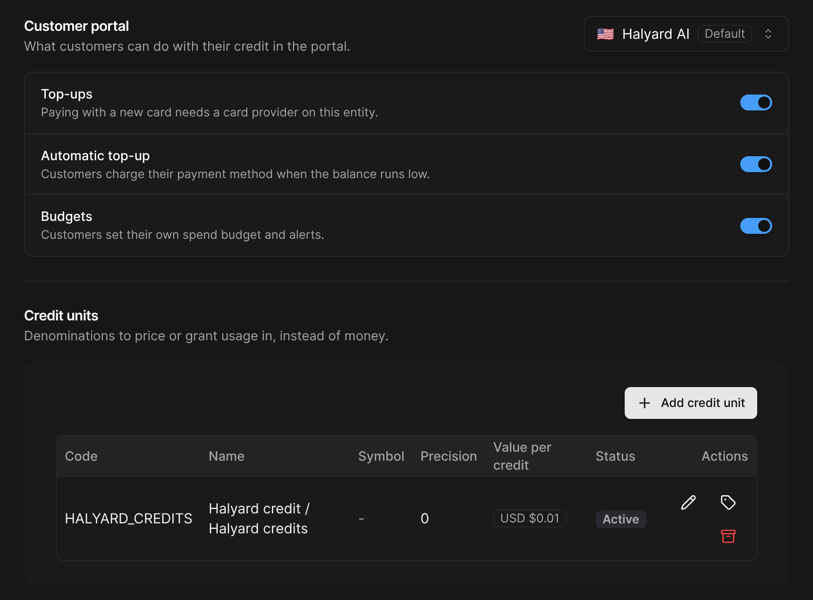

A **credit unit** is a currency of credit you define, such as "API credits". You price usage in it, include it in plans, and sell it at a price you set per currency. Customers see their usage and allowance in credits: only what their credits don't cover is billed in money.

Use credit units when you want a stable allowance ("5,000 credits a month") whose money value you control separately, or a single price list across currencies. Use money credit when customers simply prepay a spend.

## Defining a credit unit

Go to **Settings > Credit > Credit units** and click **Add credit unit**.

<Frame>
  
</Frame>

| Field | Description |
| --- | --- |
| **Code** | 4 to 16 characters, e.g. `API_CREDITS`. Cannot be changed |
| **Name (singular / plural)** | E.g. "API credit" / "API credits". Shown to customers, can be renamed |
| **Symbol** | Optional |
| **Precision** | Decimal places, 0 to 6. Cannot be changed |
| **Value per credit** | What one credit is worth in your default currency, e.g. `0.01`. Tick **No money value** for a free allowance only |

To sell a unit, open its prices (tag icon) and set:

* a **value per credit** in each currency you sell it in,
* a **tax product**, whose tax category applies to every sale of the unit.

Archiving a unit stops new prices, packs, grants and sales in it. Existing credit keeps working.

## What a credit is worth

A unit's value per credit is used for sales (top-ups and purchases), for overage, and to show the money equivalent of a balance. It can be overridden:

* **per plan**: the component's **Overage price per credit**,
* **per customer**: the **Agreed price per credit**, in the wallet settings. It replaces the list price for this customer's purchases, top-ups and overage.

## Pricing usage in credits

In the plan editor:

* on a **usage-based** component, choose **Priced in** "&lt;your unit&gt;",
* on a **capacity** component, choose **Overage priced in** "&lt;your unit&gt;" (the capacity fee stays in money).

Each period, usage is priced in credits, paid from the customer's credit, and only the credits not covered are billed in money, at the customer's agreed price, else the component's overage price, else the unit's value.

**Example.** A $49 plan with 5,000 included credits a month, overage at $0.01 a credit:

| Month | Credits used | Covered by credit | Overage | Invoice (before tax) |
| --- | --- | --- | --- | --- |
| 1 | 5,480 | 5,000 | 480 × $0.01 = $4.80 | $53.80 |
| 2 | 4,380 | 4,380 | — | $49.00 |

The invoice line reads e.g. "5,480 API credits used, 5,000 paid with credit".

## Funding a credit-unit wallet

* **Included credit pack** in a plan (promotional, not taxed),
* **Paid credit pack** in a plan, or a **sale** from the dashboard, the portal or an automatic top-up: taxed when sold, with the unit's tax product,
* **Add credit > Free credits** (promotional).

Credits covered by the wallet are never taxed again when they are used.

<Note>
  A credit note on a line priced in credits only credits the money billed for overage. To give credits back, void the invoice or add free credits.
</Note>
