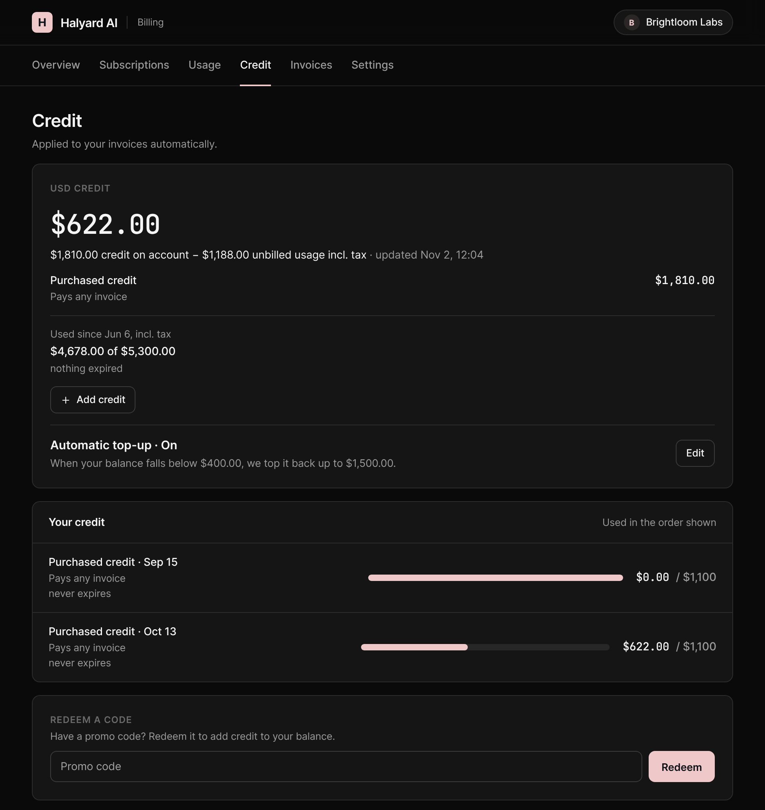

Customers see their credit in the [Customer Portal](/customer/customer-portal):

* **Overview**: the balance, the usage of the period with a forecast ("covered by credit through…", "runs out ≈…"), budgets and limits, and alerts when the balance is at zero or an automatic top-up has stopped.
* **Credit** tab: the balance of each wallet, the next credit and next expiry, the automatic top-up, every grant in the order it is used, and a statement of all movements.

<Frame>
  
</Frame>

## Self-service actions

Go to **Settings > Credit**, section **Customer portal**, pick an invoicing entity and enable:

| Switch | What customers can do |
| --- | --- |
| **Top-ups** | Buy credit with a saved payment method or a new card |
| **Automatic top-up** | Top up from a saved card when their balance runs low |
| **Budgets** | Set their own spend budget and alerts |

All three are **off** by default. Top-ups and automatic top-up also need a way to pay: an active card provider on the invoicing entity, or a saved card. When customers can't buy credit, the portal asks them to contact you instead.

Whatever the settings, customers can always see their balance and usage, see the budgets you set for them, redeem promotion codes, and turn automatic top-up off.
