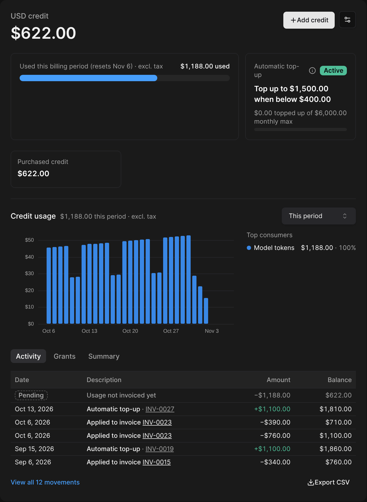

Credit is value a customer holds with you. It is applied automatically to their invoices and usage, before any payment is collected. Customers get credit by **buying it**, by **receiving it with a plan**, or because **you give it**.

Use credit to:

* Sell prepaid usage (e.g. "$500 of API usage"), with optional automatic top-up
* Include an allowance in a plan (e.g. "5,000 credits a month"), with rollover
* Offer welcome credit, promotion codes or goodwill credit after an incident
* Stop or cap usage once the credit runs out

<Frame>
  
</Frame>

## Wallets and grants

* A **wallet** holds one customer's credit, either in a **currency** (e.g. "USD credit") or in a **credit unit** you define (e.g. "API credits"). A wallet opens automatically the first time credit is added to it.
* A **grant** is one amount of credit in a wallet, with its own type, expiry and scope: $500 bought on March 1st, 5,000 credits included with a plan this month, $25 of goodwill credit.
* The **ledger** records every movement: credit added, applied to an invoice, expired, removed or returned.

See [Wallets and grants](/credits/wallets-and-grants).

## Promotional and paid credit

|  | Promotional credit | Paid credit |
| --- | --- | --- |
| What it is | Credit you give: included with a plan, welcome credit, promotion codes, bonus credit, goodwill | Credit the customer paid for: top-ups, paid credit packs, payments received outside Meteroid, overpayments |
| On the invoice | A price reduction, applied **before tax** (after coupons) | A means of payment, applied **after tax** |
| On invoices, shown as | **Free credit** (**Promotional credit** on PDFs) | **Credits applied** |

In a money wallet, promotional credit is always used before paid credit.

**Example.** $100 of usage, 10% tax, $30 of promotional credit and $50 of paid credit:

| Line | Amount |
| --- | --- |
| Subtotal | $100.00 |
| Promotional credit | −$30.00 |
| Tax (10% of $70.00) | $7.00 |
| Total | $77.00 |
| Credits applied | −$50.00 |
| **Amount due** | **$27.00** |

## Money credit or credit units

|  | Money credit | Credit units |
| --- | --- | --- |
| Denomination | A currency (USD, EUR…) | A unit you define ("API credits") |
| Pays | Any invoice in that currency | Usage priced in that unit |
| Tax | Charged on the invoices the credit pays | Charged when the credit is sold |
| Best for | Customers prepaying a spend | Selling an allowance whose money value you control |

Credit is never converted between currencies, or between a unit and money. See [Credit units](/credits/credit-units).

## How credit is applied

* Credit is applied when an invoice is **finalized**. Draft invoices show the credit expected.
* Credit never pays for credit purchases (credit packs or top-ups).
* When several grants can pay, the most specific one is used first, then the one that expires soonest. See [Order of consumption](/credits/wallets-and-grants#order-of-consumption).

## Balance and unbilled usage

Usage is priced continuously between invoices, so the wallet shows what is really left:

| Figure | Meaning |
| --- | --- |
| **Credit on account** | Credit that can be spent now |
| **Unbilled usage** | Usage not invoiced yet that the credit is expected to pay |
| **Balance** | Credit on account − unbilled usage |
| **Scheduled** | Credit granted with a later start date |

The balance is never shown below zero: usage the credit cannot cover is shown as "beyond credit" and billed on the next invoice. To stop serving usage at zero, see [When credit runs out](/credits/limits-and-budgets#when-credit-runs-out).

<Note>
  Balances can take a few minutes to update after new usage events.
</Note>

## Next steps

<CardGroup cols={2}>
  <Card title="Wallets and grants" icon="wallet" href="/credits/wallets-and-grants">
    Add, remove and expire credit, and how it shows on invoices.
  </Card>
  <Card title="Credit in plans" icon="box" href="/credits/credit-packs">
    Sell or include credit packs, with bonus and rollover.
  </Card>
  <Card title="Top-ups" icon="arrow-up" href="/credits/top-ups">
    One-off purchases, automatic top-up and low-balance alerts.
  </Card>
  <Card title="Limits and budgets" icon="gauge" href="/credits/limits-and-budgets">
    What happens when credit runs out, and spend budgets.
  </Card>
</CardGroup>
