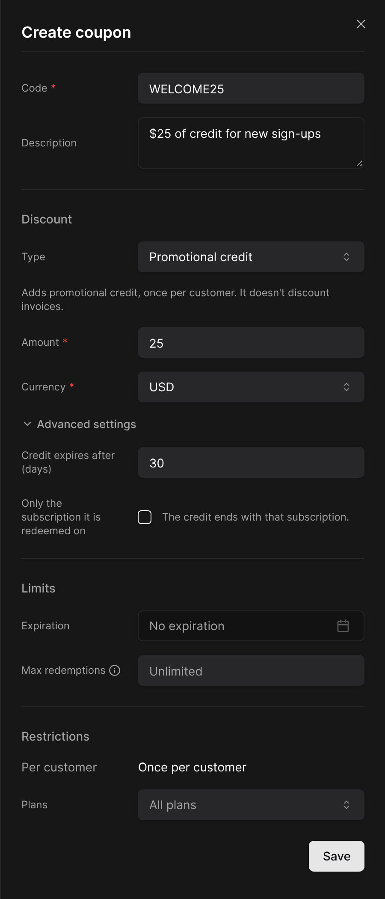

Promotional credit is credit you give rather than sell. It costs the customer nothing and works like a discount: it comes off **after coupons and before tax**, and is used before any paid credit in a money wallet.

It comes from included credit packs, bonus credit, free credit you add by hand and promotion codes. See [Where credit comes from](/credits/wallets-and-grants#where-credit-comes-from).

**Example.** A $100 fee, a 10% coupon and $20 of goodwill credit, with 8% tax: $100 − $10 − $20 = $70 taxable, $5.60 of tax, $75.60 in total.

<Tip>
  To compensate an outage without discounting the subscription fee, add **Free credit** with **Pays** set to **Usage only**.
</Tip>

## Promotion codes

### Creating a credit coupon

Go to **Product Catalog > Coupons**, click **New coupon**, and choose the type **Promotional credit**.

<Frame>
  
</Frame>

| Field | Description |
| --- | --- |
| **Amount**, **Currency** | The credit granted |
| **Credit expires after (days)** | Counted from the moment the credit is added. Empty: never |
| **Only the subscription it is redeemed on** | The credit then ends with that subscription. Otherwise it is customer-wide |
| **Expiration** | Until when the code can be redeemed |
| **Max redemptions** | Across all customers |
| **Plans** | The plans the code is valid on. Empty: all plans |

A credit coupon can be redeemed **once per customer**. Codes are not case-sensitive: `launch100` redeems `LAUNCH100`.

### Redeeming a code

| Where | How |
| --- | --- |
| Dashboard | Pick the coupon when creating a subscription |
| Hosted checkout | **Add promotion code** |
| Customer Portal | Credit tab, **Redeem a code** |
| API | `coupon_codes` when creating a subscription |

The credit is added when the subscription **starts**: right away for an active or trialing subscription, on activation after checkout, or on the start date. A checkout that is abandoned never grants it. In the portal, the code is redeemed on an active subscription in the coupon's currency, on a plan the coupon allows.
