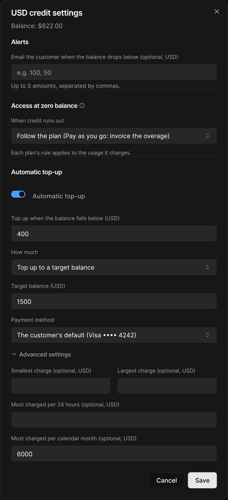

A **top-up** is a purchase of prepaid credit outside any plan: the customer pays now, and the credit pays their next invoices. An **automatic top-up** buys credit when the balance runs low.

## One-off top-up

### From the dashboard

On the customer's wallet, click **+ Add credit** and choose **Sell credit**, then:

| Payment | When the credit is added |
| --- | --- |
| **Charge now**, on a saved payment method | Once the payment succeeds. A declined charge leaves no invoice behind |
| **Send an invoice**, paid like any other invoice | Once the invoice is paid |

You can set an expiry in months (empty: the credit never expires). For a credit unit, set the quantity; the price per credit defaults to the customer's agreed price, else the unit's list price.

### From the customer portal

When top-ups are enabled (see [Customer portal](/credits/customer-portal)), customers click **Add credit** on their Credit tab, pick an amount and a payment method, then **Confirm and pay**. Credit bought in the portal never expires.

### Invoicing and tax

Each top-up creates a one-off invoice with a single credit line. A top-up in a currency is not taxed when sold: tax is charged on the invoices the credit later pays. Credit units are taxed when sold.

<Note>
  Top-ups are charged through **Stripe**. A charge must be between 1.00 and 10,000.00 (in a two-decimal currency), with at most 10 charge attempts per customer every 24 hours.
</Note>

## Automatic top-up

### Setting up a rule

Open the wallet settings (gear icon, or **Set up** on the **Automatic top-up** card):

<Frame>
  
</Frame>

| Field | Description |
| --- | --- |
| **Top up when the balance falls below** | The trigger |
| **How much** | **Top up to a target balance**, or **Add a fixed amount** |
| **Payment method** | The customer's default, or another saved method |
| **Advanced settings** | Smallest and largest charge, and the most charged per 24 hours and per calendar month |

**Example.** Trigger $400, top up to $1,500. With $900 on account and $520 of unbilled usage, the balance is $380: $1,120 is charged.

### The customer's agreement

An automatic top-up charges the customer's card while they are not present, so it needs their agreement:

* When **you** set or change the terms, tick **The customer agreed to automatic charges on these terms**. Your name and the date are recorded.
* **Customers** can set their own rule in the portal and confirm it with **Authorize**. If you later change terms they confirmed, the rule waits until they confirm the new ones.

### Failures

| Failure | Effect |
| --- | --- |
| Soft decline (insufficient funds, processing error…) | Retried after 5, then 15 minutes. Stopped after the third failure in a row |
| Hard decline (expired or lost card, authentication required…) | Stopped at once |
| Top-up refunded or disputed | Stopped at once |
| Price of the credit unit changed | Stopped until the new price is authorized |
| Monthly or daily cap reached | Postponed until there is room again (not a failure) |

The customer is emailed on the first failure. Failing or stopped rules show on the wallet, in **Billing > Wallets**, and as a **Credit access** signal on the customer.

A stopped rule resumes when the customer authorizes it again in the portal, or when you update its terms with the customer's agreement.

## Low-balance alerts

In the wallet settings, under **Alerts**, enter up to five amounts (e.g. `100, 50`). The customer is emailed each time the balance drops below one of them.

The email is sent to the customer's invoicing emails. You can turn it off in **Settings > Customer emails**, under **Prepaid balance**.

<Tip>
  Low balances and automatic top-ups also send webhooks, e.g. `wallet.balance_low`, `wallet.depleted` and `wallet.auto_top_up_cap_reached`.
</Tip>
