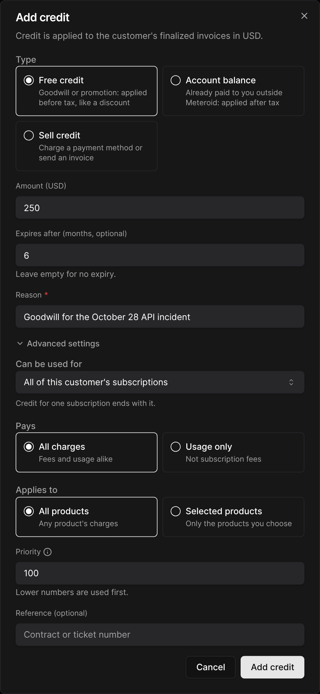

## The Credit tab

Each customer's credit is on their page, in the **Credit** tab. A wallet shows:

* the **balance**, with **+ Add credit** and the wallet settings (gear icon),
* the usage of the current billing period, and a projection to the end of the period,
* the **automatic top-up** rule, if any,
* the credit grouped by kind: **Included with &lt;plan&gt;**, **Purchased credit**, **Free credit** and **Account balance**,
* a **Credit usage** chart, by metric, with the top consumers,
* the **Activity** (ledger, exportable as CSV), the **Grants** and a **Summary**.

When the customer has several subscriptions, a **Subscription** filter narrows the wallet to the credit a given subscription can spend.

To see every customer's wallet at once, go to **Billing > Wallets**, and filter on low, depleted or blocked wallets, or failing top-ups.

| Status | Meaning |
| --- | --- |
| **Low** | Below a low-balance alert, or at the automatic top-up trigger |
| **Depleted** | Balance at zero: further usage is billed on the next invoice |
| **Access denied: no credit** | Balance at zero, and access is denied at zero (see [When credit runs out](/credits/limits-and-budgets#when-credit-runs-out)) |
| **Top-up failing / stopped** | The automatic top-up's last charges failed, or the rule is stopped |

## Where credit comes from

| Source | Type | Learn more |
| --- | --- | --- |
| Top-up, automatic top-up | Paid | [Top-ups](/credits/top-ups) |
| Paid credit pack in a plan | Paid (+ bonus) | [Credit in plans](/credits/credit-packs) |
| Included credit pack, rollover, welcome credit | Promotional | [Credit in plans](/credits/credit-packs) |
| Promotion code | Promotional | [Promotional credit](/credits/promotional-credit) |
| **Add credit** > Goodwill / promotional | Promotional | Below |
| **Add credit** > Paid outside Meteroid | Paid | Below |
| Credit note applied as customer credit, overpayment | Paid | [Credit notes](#credit-notes-and-refunds) |

## Adding credit by hand

On the wallet, click **+ Add credit** and choose a **Type**:

* **Goodwill / promotional**: a discount, applied before tax. Use it to compensate an outage or for a commercial gesture.
* **Paid outside Meteroid**: money you already received (wire, cheque…), applied after tax. A payment reference is required for French invoicing entities.
* **Sell credit**: charge the customer now or send them an invoice. See [Top-ups](/credits/top-ups).

<Frame>
  
</Frame>

Goodwill credit has **Advanced settings**:

| Field | Options |
| --- | --- |
| **Can be used for** | All of the customer's subscriptions, or one subscription only (the credit then ends with it) |
| **Pays** | All charges, or **Usage only** (never subscription fees) |
| **Applies to** | All products, or selected products |
| **Expires after** | 1 to 120 months. Empty: never expires |
| **Priority** | Lower numbers are used first (default 100) |

The **Reason** is shown in your ledger only, never to the customer.

## Order of consumption

When an invoice is finalized, credit is used in this order:

1. **Promotional before paid** (money wallets): promotional credit comes off before tax, paid credit then pays the taxed total.
2. **Most specific first**: credit for that subscription, then credit restricted to products, then usage-only credit, then credit for any charge.
3. **Lowest priority** number.
4. **Soonest to expire**. Credit that never expires goes last.

The **Grants** tab lists the grants in this order.

## Expiry

When a grant expires, the usage it could pay that is not invoiced yet is paid from it first, so credit is never lost to invoice timing. What remains then expires.

Credit that belongs to a subscription (plan credit, welcome credit, credit scoped to it) pays its usage up to the end of the subscription, then ends with it. Customer-wide credit is not affected.

## Removing credit

Only credit added by hand can be removed, and only its unspent part: open the grant in the **Grants** tab, click **Remove**, then enter an amount and a reason.

Grants cannot be edited: to correct one, remove it and add it again. Purchased credit is reversed with a refund instead (below).

## Credit notes and refunds

* A **credit note** returns the credit that paid the credited lines to the grants that paid them. Choose **Apply as customer credit** to turn the money part into customer credit that never expires.
* **Refunding purchased credit**: issue a **Refund** credit note on the invoice that sold the credit. Only the unspent credit is refunded: a customer who bought $1,000 of credit and used $620 gets $380 back.
* **Voiding** an invoice returns every credit it used.
* **Chargebacks and refunds made at your payment provider** take back the unspent credit the payment bought. A refunded or disputed top-up also stops the automatic top-up.

## Several subscriptions: usage filters

A customer can hold several subscriptions billing the same metric, e.g. one per team or per API key, each with its own credit. Set a **Usage filter** on each subscription (a property and a value, e.g. `api_key = key-A`, under **Advanced Settings**) so that each subscription bills, and spends credit on, its own events only.

A subscription without a usage filter bills the events that no other subscription's filter matches.
